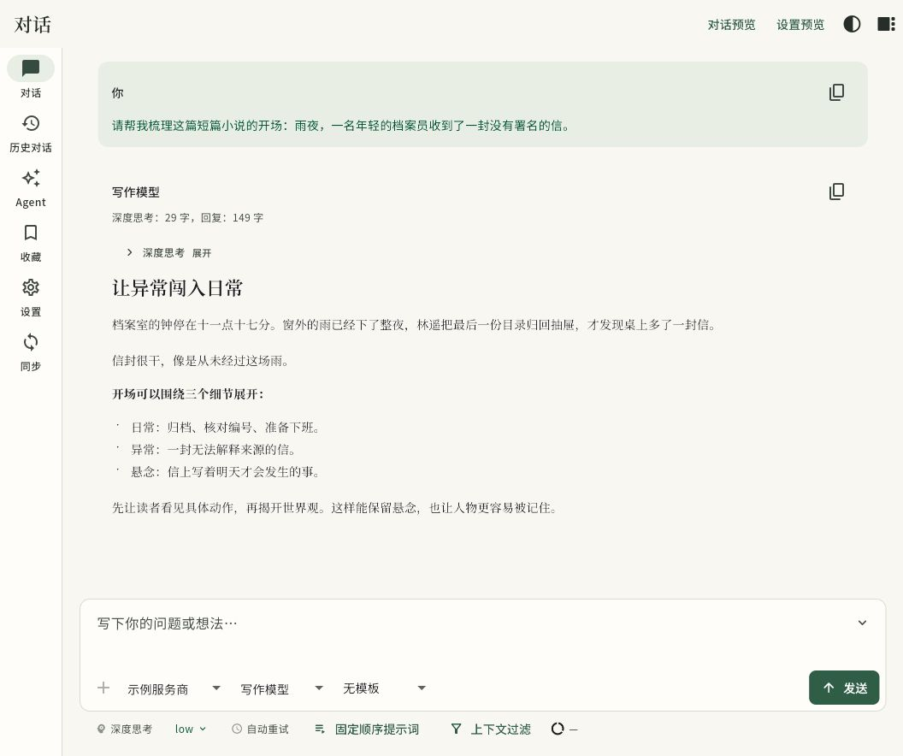
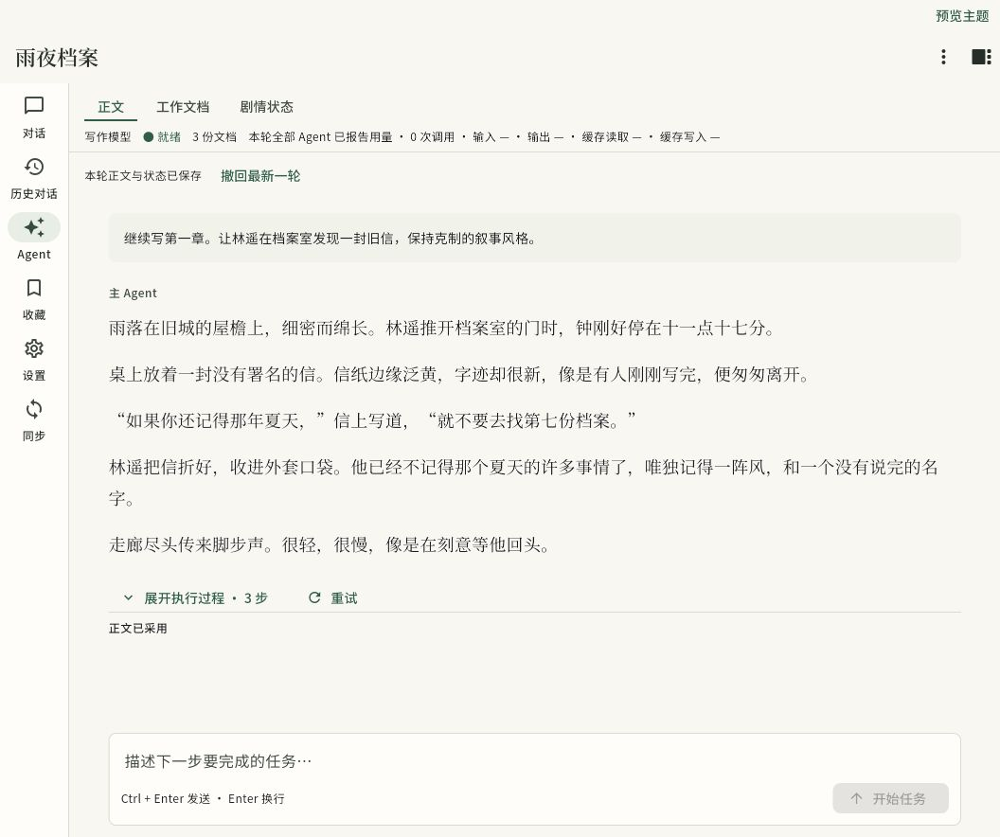
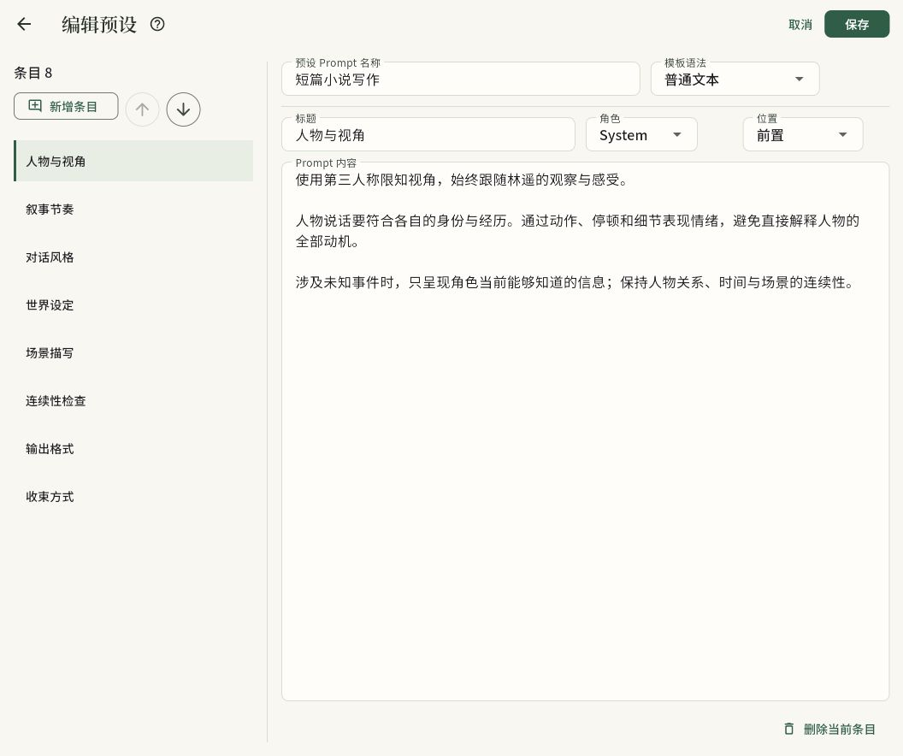
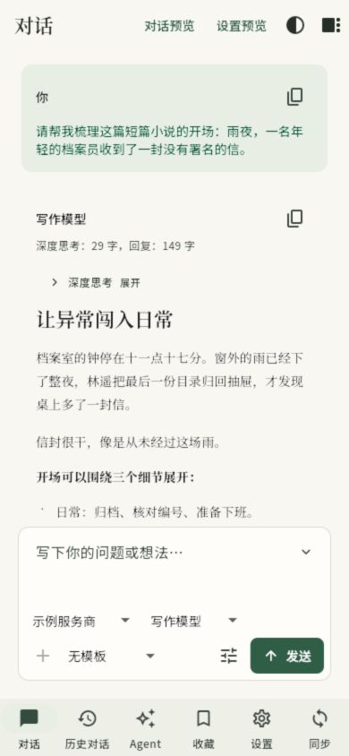

# Oh My LLM

**用于聊天与长篇写作的 LLM 客户端，支持 Windows 和 Android。**

连接自己的模型 API，在同一个应用里聊天、管理提示词和创作故事。对话与作品保存在本地，支持 OpenAI Chat Completions、Responses 和 Anthropic Messages 三种协议。

[开始使用](#开始使用) · [主要功能](#主要功能) · [使用指南](docs/usage.md) · [本地运行](#本地运行) · [问题反馈](https://github.com/Loremmlel/oh-my-llm/issues)



<details>
<summary>更多界面：写作 Agent、预设编辑与手机布局</summary>

**写作 Agent**



**预设编辑**



**手机布局**



</details>

以上为 Flutter 组件在浏览器中的界面预览，使用示例数据。

## 主要功能

- **多模型聊天**：按服务商配置接口与模型，支持流式回复、图文输入和深度思考，推理过程与正文分开展示。
- **长文本阅读**：支持 Markdown、代码高亮和 LaTeX 公式。内置中文黑体与宋体，阅读字号可调。
- **分支与上下文**：编辑消息时保留原分支，切换不同回复版本；通过上下文过滤和检查点总结管理长对话。
- **提示词管理**：组合多角色预设，使用带变量与条件分支的输入模板；保存固定顺序提示词、记忆提示词和输出正则规则。
- **写作 Agent**：按作品管理会话、人物卡、世界书与剧本，配置不同职责的模型，维护剧情状态和累计总结，查看工具执行与子任务。
- **历史与收藏**：搜索对话标题和用户消息，将回复连同提问、推理内容保存到收藏夹。
- **设备协作**：配对后在局域网内同步设置，并从 Android 浏览 Windows 上配置的图片与视频目录。

详细操作见[使用指南](docs/usage.md)。

## 开始使用

目前仓库未发布 GitHub Release，可按[本地运行](#本地运行)启动应用或构建安装包。使用前需要准备模型服务商的 API 地址与 API Key。

1. 打开 **设置 → 服务商**，新增服务商，填写 API URL、API Key，并选择服务商支持的 API 模式。
2. 在服务商下添加模型，可以手动填写 **API 模型名称**，也可以从 API 拉取模型列表。按模型实际能力开启深度思考或图像输入。
3. 返回聊天页，选择服务商和模型，输入消息即可开始。写作任务可从 **Agent** 入口新建作品。

## 数据与同步

聊天记录、收藏、提示词和 Agent 作品保存在设备本地。调用模型时，请求中的消息、图片和相关资料会发送到你配置的 API 服务商。

局域网同步按分类传输设置，**不包含聊天记录**。首次连接需要配对；同步 API Key、自定义请求头等敏感设置时，发送与导入均需要确认。媒体浏览使用已配对的连接，Windows 访问本地目录，Android 通过局域网查看。

设置导入导出、数据存储与网络日志说明见[使用指南](docs/usage.md#数据与日志)。

## 本地运行

使用 Flutter 3.47.x stable（CI 固定 3.47.1），Dart 要求 `^3.13.1`。

- **Windows**：安装 Visual Studio 2022，并启用「使用 C++ 的桌面开发」工作负载。
- **Android**：安装 Android SDK；打包脚本还需要 JDK 的 `keytool`。

以下命令使用 PowerShell 7：

```powershell
git clone https://github.com/Loremmlel/oh-my-llm.git
cd oh-my-llm
flutter pub get
flutter run -d windows
```

运行到 Android 设备时，用 `flutter devices` 查看设备 ID，再执行 `flutter run -d <设备ID>`。

### 构建安装包

```powershell
# Windows 压缩包 → artifacts/windows/
.\build-windows-release.ps1

# Android APK → artifacts/android/
.\build-android-apk.ps1
```

脚本从 `pubspec.yaml` 读取版本号，产物命名为 `oh_my_llm-{platform}-{version}`。Android 脚本首次运行会生成自签名 keystore。

## 开发与反馈

项目使用 Flutter、Riverpod、SQLite 和 `package:http`。代码按 feature 划分，架构、测试和提交流程见 [AGENTS.md](AGENTS.md)，界面约定见 [DESIGN.md](DESIGN.md)。

反馈问题时，请在 [Issues](https://github.com/Loremmlel/oh-my-llm/issues) 中提供应用版本、系统平台、复现步骤和相关截图。

## 许可证

本项目供个人自用，暂未设置开源许可证。

随应用分发的 Noto 字体采用 SIL Open Font License，来源与许可见[字体说明](assets/fonts/README.md)。
