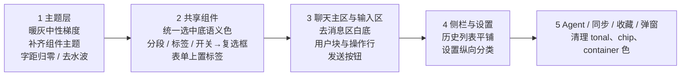

# 四月 UI 书卷风改造 · 残留问题审计报告

扫描范围：`lib/app/theme`、`lib/app/shell`、`lib/core/widgets`、各 feature 的 `presentation/`，并对照 `logs/worldbooks-layouts-refined/` 中最近一次渲染截图与 `docs/design/ui-redesign/references/` 参考图。颜色主题（墨绿 `#2F5D46` / 暖白 `#F8F7F2`）保持不变，下面只讨论“用法”和“质感”。

---

## 一、根因：为什么改了还是像 M3

改造主要做在**页面结构**上（去卡片、平铺、分隔线），但**主题层只覆盖了 8 个组件**（AppBar、Card、Input、三种 Button、Dialog、PopupMenu、SnackBar）。其余所有 Material 组件都在吃 M3 默认样式：

| 未主题化的组件 | 在 App 里的实际样子 | 出现位置 |
| --- | --- | --- |
| `Switch` | 粗胶囊轨道 + 墨绿实心填充，一排就是一排深绿色块 | 对话侧栏预设条目、单 System、输出规则、其它设置、上下文过滤 |
| `SegmentedButton` | 体育场形描边 + 选中打勾 + 绿底 | 对话侧栏切换、模型表单、同步模式、重试模式、网卡掩码 |
| `TabBar` | 绿色下划线 + 绿色选中文字 + 通栏灰线 | 设置、同步 |
| `NavigationRail` / `NavigationBar` | M3 胶囊指示器、64px 高底栏带底色 | 中等宽度侧栏、手机底栏 |
| `ExpansionTile` | 展开后标题和图标变绿，上下自动画分隔线 | Agent 步骤、剧情状态、上下文、SillyTavern 导入 |
| `FilterChip` / `ChoiceChip` | M3 圆角 chip，选中实心底 | 模型能力、Agent 职责、Agent 文档切换、思考强度 |
| `FloatingActionButton` / `FilledButton.tonal` / `IconButton.outlined/filledTonal` | 有阴影的 FAB、浅绿色块按钮、圆形描边图标按钮 | 回到底部、回到最新、检查点、删除消息、条目上下移 |
| `ListTile` | 选中时文字与图标整体变墨绿 | 主侧栏、历史侧栏 |
| `InputDecoration` + `labelText`（76 处） | 描边框 + 缺口浮动标签，这是 M3 最有辨识度的一处 | 几乎所有表单、侧栏世界书/预设选择器 |
| Dialog / Popup 默认 elevation | 弹窗和菜单仍带 M3 阴影 | 全局 |
| 水波纹（InkRipple / Android InkSparkle） | 点击扩散水波 | 全局 |

另外有一批**组件级直接取 M3 容器色**（`primaryContainer` 16 处、`secondaryContainer` 14 处、`tertiaryContainer` 5 处），以及少量写死的 Material 调色板颜色（`Colors.green`、`#43A047`、`#EF6C00`、RGB 橙/红）。这些在主题里改不到，所以“补主题”和“清组件”两步都要做。

---

## 二、全局层（主题 / token）

### 1. 中性色偏绿灰，与暖白画布打架
[app_theme.dart](file:///e:/Code/oh-my-llm/lib/app/theme/app_theme.dart#L51-L62) 里 `surfaceContainer` `#EEF0E8`、`surfaceContainerHigh` `#E7EADF`、`surfaceContainerHighest` `#DFE4D8`、`outlineVariant` `#D8DDD1` 全部带绿色倾向，而画布 `#F8F7F2` 是暖调。截图里左侧栏（surfaceContainer）明显比主区“冷、绿、灰”。其余未显式指定的 `outline`、`onSurfaceVariant`、`secondary`、`tertiary`、`inverseSurface` 仍由 `fromSeed` 生成，是 M3 色调体系。

**建议**：主色、画布、卡片面色不动；把 surfaceContainer 系列、outline/outlineVariant、onSurfaceVariant 改成**同一个暖灰梯度**（往黄褐方向偏，不往绿偏），绿色只留给 primary 和极浅的选中底。`secondary*`、`tertiary*` 显式钉成中性色或主色，避免 seed 生成的蓝绿色意外露出。深色同理：可保持现在的深绿黑基调，但 container 梯度要从同一色相推出，不要混入 seed 生成色。

### 2. 补齐组件主题（最高性价比的一步）
在主题里统一定义上表所有组件，原则：

- **Switch**：缩小（或整体换成复选框/勾选样式），关闭态浅暖灰轨道、无描边；打开态才用墨绿。列表里密集的“启用”开关优先改为**复选框**——Claude 列表里几乎看不到大开关。
- **SegmentedButton**：去掉打勾，改成浅底轨道里一个白色/卡片色“滑块”的分段样式，或者直接用文字下划线标签；选中靠字重和底色微差，不用绿底。
- **TabBar**：指示器改细（2px）且用前景色或墨绿，选中文字用 onSurface 加粗而非绿色；去掉通栏 divider 或改成 outlineVariant 细线。
- **ExpansionTile**：`shape`/`collapsedShape` 设为无边框，展开后图标与文字颜色保持不变。
- **Chip**：统一扁平、细边框、圆角 8，选中只换浅底不变绿字。
- **ListTile**：`selectedColor` 设为 onSurface，选中靠浅底 + 字重表达。
- **NavigationBar / NavigationRail**：指示器颜色改成极浅暖灰或去掉，底栏背景与画布同色，顶部一条细线分隔，高度压低。
- **Dialog / Popup / Menu / BottomSheet / Drawer**：elevation 0 或极轻阴影，配 1px outlineVariant 边框，统一 surface。
- **Tooltip**：M3 默认深灰块改成暖色深底或卡片色 + 细边。
- **全局水波纹**：`splashFactory` 换成无水波（仅保留 hover/pressed 底色变化）。
- **FAB**：主题里去阴影；或者干脆不用 FAB（见下文聊天页）。

### 3. 字体层级细节
- M3 默认 textTheme 带英文字距（`bodyMedium` 0.25、`bodySmall` 0.4、`labelLarge` 0.1），中文会显得松散——截图里“单 System Prompt”就很明显。**建议全部归零**。
- 聊天正文 `bodyMedium` 只有 14px 宋体，读起来偏小、偏挤；Agent 正文却是 18px。两边阅读区建议统一到 16–17px 宋体（仍受用户字号偏好缩放），保留 1.85 行高。
- `titleMedium/titleSmall` 仍是 M3 默认尺寸与字重，设置分组标题显得“像表单”。可以把区域标题收紧到 15–16px、w600，与正文拉开靠字重而不是字号。

### 4. 圆角 token 未被遵守
代码中散落着 2 / 4 / 10 / 14 / 16 / 999 等圆角（tokens 只有 8 / 12 / 16）。[composer_pill_toggle.dart](file:///e:/Code/oh-my-llm/lib/features/chat/presentation/widgets/composer/controls/composer_pill_toggle.dart#L44) 用 4、[conversation_history_panel.dart](file:///e:/Code/oh-my-llm/lib/features/chat/presentation/widgets/sidebar/conversation_history_panel.dart#L50) 用 14、通知气泡用 16、各类小徽标用 10/999。**建议**统一到 token，小徽标可以新增一个“tag”级别（例如 6），不要再用全胶囊 999。

---

## 三、逐页面 / 组件问题与改法

严重度：🔴 一眼 M3 / 明显违和　🟡 不统一、偏重　🟢 细节

### A. 外壳导航

| 组件 | 问题 | 建议 |
| --- | --- | --- |
| 🔴 [AppShellScaffold](file:///e:/Code/oh-my-llm/lib/app/shell/app_shell_scaffold.dart#L118-L139) 手机底栏 | 原生 M3 `NavigationBar`：胶囊指示器、带底色、64px | 见全局主题；或改为画布同色 + 顶部细线 + 小图标文字，选中仅图标填充/文字加粗 |
| 🔴 同文件 [中等宽度 Rail](file:///e:/Code/oh-my-llm/lib/app/shell/app_shell_scaffold.dart#L200-L217) | 原生 M3 `NavigationRail`，与宽屏侧栏完全两种风格 | 做成宽屏侧栏的“仅图标”版本，复用同一套选中样式 |
| 🟡 同文件 [宽屏侧栏](file:///e:/Code/oh-my-llm/lib/app/shell/app_shell_scaffold.dart#L254-L299) | 上方导航项有 8px 圆角，底部“设置/同步”没设 shape，选中底是直角（截图可见）；选中时文字、图标变绿 + 绿底，三重强调 | 抽成同一个导航项组件；选中只用浅底 + 字重，图标与文字保持 onSurface |
| 🟡 侧栏底色 | `surfaceContainer` 绿灰，和右侧暖白主区色相不一致 | 随全局暖灰梯度修正 |

### B. 聊天主区

| 组件 | 问题 | 建议 |
| --- | --- | --- |
| 🔴 [ChatMessagesPanel](file:///e:/Code/oh-my-llm/lib/features/chat/presentation/widgets/messages/chat_messages_panel.dart#L74-L76) | 消息区单独铺了一块 `surface` 白底，嵌在暖白画布里，形成“页中卡片”，四周留出不规则的缝（截图顶部、左右、底部都能看到边） | 消息区直接用画布色，与顶栏、输入区同底；层次只靠输入框自身的边界 |
| 🔴 同文件 [回到底部 FAB](file:///e:/Code/oh-my-llm/lib/features/chat/presentation/widgets/messages/chat_messages_panel.dart#L138) | M3 小 FAB，浅绿容器 + 阴影 | 换成圆形细边框的卡片色小按钮，无阴影，悬浮在输入框上方居中 |
| 🟡 MessageAnchorRail | 右侧一根带圆角描边的竖条，静止时也一直在，视觉上像多出来的滚动条 | 默认只显示刻度点，无外框；hover 才出现预览 |
| 🔴 [ChatMessageBubble](file:///e:/Code/oh-my-llm/lib/features/chat/presentation/widgets/messages/bubble/chat_message_bubble.dart#L178-L245) 用户消息 | 用户正文用 `onPrimaryContainer`，**整段绿色字**，读起来像链接；“你 + 3 个图标”独占一行，让用户块变得很高 | 用户正文用 onSurface；去掉“你”标题行，块内只放正文；操作移到块外右下或 hover 时出现 |
| 🔴 同文件 助手消息头 | 每条消息头部常驻 4 个 24px 实心 Material 图标（复制、收藏、重试、更多），比正文还抢眼 | 参考图做法：图标缩到 16–18px、次级色，配文字（复制 / 重试 / 收藏）放在正文**下方**一行；DESIGN 里“动作在头部”的约定建议同步修改 |
| 🟡 同文件 [finish reason 徽标](file:///e:/Code/oh-my-llm/lib/features/chat/presentation/widgets/messages/bubble/chat_message_bubble.dart#L372-L417) | `stop` 用 seed 生成的 `tertiaryContainer`（偏蓝绿），`length`/`content_filter` 写死 Material 橙/红 RGB；每条正常结束的消息都挂一个彩色胶囊 | 正常 `stop` 不显示；异常原因用小号次级文字 + 图标，颜色走 error / 一个统一的 warning 语义色 |
| 🟡 同文件 元信息 | 字数、检查点、token 用量、finish reason 分散在正文上方和下方 | 统一成正文下方一行小号次级文字（`字数 · 输入 · 输出 · 原因`），上方只留作者和推理折叠 |
| 🟡 [ReasoningPanel](file:///e:/Code/oh-my-llm/lib/features/chat/presentation/widgets/messages/bubble/reasoning_panel.dart#L95-L104) | 展开后推理内容与正文同字号、同颜色的宋体，没有任何区分 | 展开内容用左侧细竖线 + 次级色、略小一号，折叠行写成“深度思考 · 29 字” |
| 🟡 [ChatInlineEmptyReplyCard](file:///e:/Code/oh-my-llm/lib/features/chat/presentation/widgets/messages/bubble/chat_inline_empty_reply_card.dart) / ChatInlineErrorCard | 仍是 `Card` + `tertiaryContainer`/错误容器色块 | 改为左侧细色条 + 图标 + 文字的提示行，不铺整块底色 |
| 🟢 [EmptyConversationView](file:///e:/Code/oh-my-llm/lib/features/chat/presentation/widgets/messages/empty_conversation_view.dart) | 48px 聊天气泡图标 + 标题，典型 M3 空状态 | 去掉图标，改为一句大号宋体问候/标题，下方一行次级说明——这是 Claude 首页最有“书卷气”的地方 |

### C. 输入区

| 组件 | 问题 | 建议 |
| --- | --- | --- |
| 🟡 [ChatComposerCard](file:///e:/Code/oh-my-llm/lib/features/chat/presentation/widgets/composer/chat_composer_card.dart#L127) | 输入框外框是普通 Card（12 圆角、细边），与消息区白底几乎同色，存在感弱 | 输入框是全页唯一需要“浮起来”的东西：卡片色底 + 细边 + 稍大圆角（16），可以给一层很淡的阴影；其他地方都不用阴影 |
| 🔴 同文件 [编辑中横幅](file:///e:/Code/oh-my-llm/lib/features/chat/presentation/widgets/composer/chat_composer_card.dart#L149-L201) | `secondaryContainer` 浅绿色块 | 改成输入框内顶部一行次级文字 + 左侧细绿线 |
| 🔴 [ComposerSendButton](file:///e:/Code/oh-my-llm/lib/features/chat/presentation/widgets/composer/controls/composer_send_button.dart) | 80×48 的大块“发送”实心按钮；停止时整块变红 | 改为 36–40px 方形（8 圆角）图标按钮，墨绿底白箭头；停止态用深色/前景色方块 + 停止图标，红色只用于真正的危险操作 |
| 🟡 [ComposerDesktopSettingsRow](file:///e:/Code/oh-my-llm/lib/features/chat/presentation/widgets/composer/layout/composer_desktop_settings_row.dart) | 同一行里“深度思考 / 自动重试”是灰色 12px 小药丸，“固定顺序提示词 / 上下文过滤”却是**绿色** TextButton，大小和颜色都不一致；缓存命中率的 `data_usage` 图标看起来像加载圈 | 整行统一成同一种次级样式（次级色、同字号、同图标尺寸），开启态才用墨绿；缓存命中率改成纯文字“缓存 12.3%” |
| 🟡 [ComposerPillToggle](file:///e:/Code/oh-my-llm/lib/features/chat/presentation/widgets/composer/controls/composer_pill_toggle.dart) / ComposerEffortPill | 选中用 primaryContainer 色块，圆角 4（不在 token 内） | 选中态：细墨绿边或墨绿文字，不铺绿底；圆角走 token |
| 🟡 手机“更多设置”底部面板 | `showModalBottomSheet` 默认 M3 样式 + `ChoiceChip` + 两个通栏 OutlinedButton | 面板去 tint、用 surface；思考强度改分段样式；两个入口改成列表行（图标 + 文字 + 右箭头） |
| 🟢 下拉选择器 | 已无边框，但箭头是 M3 实心三角 | 统一换成细线 chevron（`expand_more`）并缩小 |

### D. 对话侧栏（历史 / 预设）

| 组件 | 问题 | 建议 |
| --- | --- | --- |
| 🔴 [ChatNavigationDrawer](file:///e:/Code/oh-my-llm/lib/features/chat/presentation/widgets/sidebar/chat_navigation_drawer.dart#L34) | 原生 `SegmentedButton`：胶囊描边 + 打勾 | 改成两枚文字标签 + 细下划线，或浅底轨道分段 |
| 🔴 [ConversationHistoryPanel](file:///e:/Code/oh-my-llm/lib/features/chat/presentation/widgets/sidebar/conversation_history_panel.dart#L45-L76) | 每条会话是一块 14 圆角色块，间隔 8px，像一列卡片；两行预览 | 参考图：单行标题、无底色、行间无缝，hover 浅底，选中浅暖灰底；预览文字可去掉或仅 tooltip |
| 🔴 [PresetPromptMessageCard](file:///e:/Code/oh-my-llm/lib/features/chat/presentation/widgets/prompts/preset_prompt_message_card.dart#L47-L78) | 每行一个墨绿机器人图标 + 一个大号 M3 开关，截图里是一整列深绿色块 | 去掉角色图标（或改为次级色小字 system/user），开关改复选框或小号中性开关 |
| 🔴 世界书 / 预设选择器 | 描边 + 浮动标签的 M3 输入框 | 标签放在字段上方作为小号次级文字，字段本身只留细边或下划线 |
| 🟡 单 System Prompt 行 | 文字因 M3 字距被挤成两行；开关 + 问号间距松散 | 字距归零；与预设条目一样改用复选框 |
| 🟡 [AppSideDrawer](file:///e:/Code/oh-my-llm/lib/core/widgets/app_side_drawer.dart) 浮动态 | M3 Drawer 默认大圆角 + surfaceContainerLow，标题 `titleMedium` | 圆角改 token 或直角贴边，左侧加 1px 细线代替阴影 |

### E. 设置

| 组件 | 问题 | 建议 |
| --- | --- | --- |
| 🔴 [SettingsWorkspace](file:///e:/Code/oh-my-llm/lib/features/settings/presentation/widgets/shared/settings_workspace.dart#L41-L89) | 7 个 Tab 的 M3 TabBar，绿色指示器 + 绿字；“提示词”Tab 内嵌了一个 48px PopupMenuButton，导致它和“网络”之间出现明显空洞（截图可见） | 宽屏改为**左侧纵向分类列表**（Claude 设置页就是这样），窄屏保留横向标签；提示词子分类做成列表的二级项或标签右侧的小 chevron，不要把 IconButton 塞进 Tab |
| 🟡 设置列表行（世界书、记忆、模板等 `SettingsEntityRow`） | 编辑 / 删除是 24px 实心深色图标，比标题还重 | 图标缩小、次级色，hover 才加深；删除进更多菜单（与模型/预设列表一致） |
| 🔴 [SettingsEditorList](file:///e:/Code/oh-my-llm/lib/features/settings/presentation/widgets/shared/settings_editor_list.dart#L31-L45) | `IconButton.outlined` 圆形描边上下移按钮；禁用态浅灰圆圈很突兀 | 改为与“新增条目”同高的方形细边按钮或纯图标按钮 |
| 🟡 同文件 选中条目 | `secondaryContainer` + 3px 墨绿竖条，两种强调叠加 | 保留竖条，底色换成浅暖灰；或保留底色去掉竖条 |
| 🔴 [PresetPromptEditor](file:///e:/Code/oh-my-llm/lib/features/settings/presentation/widgets/prompts/forms/preset_prompt_editor.dart) / WorldBookEditor | 全部字段是浮动标签描边框；“位置”下拉与“角色”之间留出大片空隙，对齐不齐 | 上置标签 + 细边字段；同一行字段用统一网格对齐；正文编辑区可以去边框，只留上下细线，更像稿纸 |
| 🟡 编辑页顶栏 | “取消”是绿色 TextButton，与“保存”实心绿按钮争色 | 取消用前景色文字按钮 |
| 🔴 [ModelCapabilityChips](file:///e:/Code/oh-my-llm/lib/features/settings/presentation/widgets/providers/model_capability_chips.dart) | M3 `FilterChip` | 改为小复选框 + 文字，与桌面表格列的复选框统一 |
| 🔴 [ModelConfigFormDialog](file:///e:/Code/oh-my-llm/lib/features/settings/presentation/widgets/providers/forms/model_config_form_dialog.dart#L158) | `SegmentedButton` 切换模式 | 同对话侧栏的分段样式 |
| 🟡 [ModelFetchSection](file:///e:/Code/oh-my-llm/lib/features/settings/presentation/widgets/providers/forms/model_fetch_section.dart#L172) | `FilledButton.tonal` + `surfaceContainerHighest` 色块 | 次级按钮统一用 Outlined；色块改细边区域 |
| 🔴 [OtherSettingsTab](file:///e:/Code/oh-my-llm/lib/features/settings/presentation/widgets/tabs/other_settings_tab.dart#L48-L149) | M3 `Slider`、`SegmentedButton`、`SwitchListTile` 三件套，是全 App 最“Material 设置页”的一页 | Slider 改细轨道小圆点；重试模式用分段样式；开关行改为“标题 + 说明 + 右侧小开关”的平铺行 |
| 🟡 [OutputProcessingTab](file:///e:/Code/oh-my-llm/lib/features/settings/presentation/widgets/tabs/output_processing_tab.dart#L230) | 每条规则一个大开关 | 随全局开关样式；或改复选框 |
| 🟡 [FixedPromptSequenceFormDialog](file:///e:/Code/oh-my-llm/lib/features/settings/presentation/widgets/prompts/forms/fixed_prompt_sequence_form_dialog.dart#L251-L256) | `IconButton.outlined` 与 `secondaryContainer` 选中块 | 同 SettingsEditorList |
| 🟢 [SillyTavernImportDialog](file:///e:/Code/oh-my-llm/lib/features/settings/presentation/widgets/prompts/forms/silly_tavern_import_dialog.dart#L208) | ExpansionTile 展开变绿 + 自动分隔线 | 交给全局 ExpansionTile 主题 |

### F. 历史 / 收藏

| 组件 | 问题 | 建议 |
| --- | --- | --- |
| 🟡 [HistoryConversationTile](file:///e:/Code/oh-my-llm/lib/features/history/presentation/widgets/history_conversation_tile.dart#L93) / [FavoriteListItem](file:///e:/Code/oh-my-llm/lib/features/favorites/presentation/widgets/favorite_list_item.dart#L56) | 选中用半透明 `primaryContainer`，与侧栏、编辑列表的选中色各不相同 | 全 App 统一一个“选中底”语义色（浅暖灰或极浅绿），所有列表共用 |
| 🔴 [FavoriteCollectionTile](file:///e:/Code/oh-my-llm/lib/features/favorites/presentation/widgets/favorite_collection_tile.dart#L92-L170) | 网格卡片 + 墨绿文件夹图标 + 右上 more 按钮，标准 M3 卡片网格 | 收藏夹数量不多，可改成平铺列表行（名称宋体、数量和日期次级文字）；若保留网格，图标改次级色或去掉 |
| 🟡 [AppSelectionToolbar](file:///e:/Code/oh-my-llm/lib/core/widgets/app_selection_toolbar.dart#L36) | 半透明 primaryContainer 绿条 | 改为卡片色 + 细边的浮动条，或顶栏内联 |
| 🟡 [FavoriteDetailScreen](file:///e:/Code/oh-my-llm/lib/features/favorites/presentation/favorite_detail_screen.dart#L101) | `FilledButton.tonalIcon` | 次级动作统一 Outlined / Text |

### G. Agent

| 组件 | 问题 | 建议 |
| --- | --- | --- |
| 🔴 [AgentTranscript 步骤](file:///e:/Code/oh-my-llm/lib/features/agent/presentation/agent_transcript.dart#L378-L452) | 每个步骤一个 ExpansionTile：展开后标题变绿、上下多出分隔线，步骤一多就是一屏绿色文字和横线 | 交给全局 ExpansionTile 主题；步骤行用次级色小字 + 状态小图标，形成“时间线”而不是列表 |
| 🟡 同文件 [回到最新](file:///e:/Code/oh-my-llm/lib/features/agent/presentation/agent_transcript.dart#L185) | `FilledButton.tonalIcon` 浅绿块 | 与聊天“回到底部”用同一个组件 |
| 🟡 同文件 [任务块](file:///e:/Code/oh-my-llm/lib/features/agent/presentation/agent_transcript.dart#L244-L258) | 半透明 primaryContainer；与聊天用户块颜色算法不同（一个 0.45 透明，一个实色） | 与聊天用户消息共用同一个“用户输入块”样式 |
| 🔴 [AgentDocumentsPanel](file:///e:/Code/oh-my-llm/lib/features/agent/presentation/agent_documents_panel.dart#L51-L57) | `ChoiceChip` 切换文档类别 | 改为下划线标签（与 Agent 顶部视图标签一致） |
| 🔴 [AgentConfigurationDialog](file:///e:/Code/oh-my-llm/lib/features/agent/presentation/agent_configuration_dialog.dart#L306-L402) | 职责 `FilterChip` + secondaryContainer 选中 | 桌面已是左侧职责导航，选中样式应与 SettingsEditorListTile 一致；chips 改复选框列表 |
| 🟡 AgentStoryPanel / AgentSummaryDialog / AgentContextDialog | 多处 ExpansionTile | 交给全局主题 |
| 🟢 [AgentNavigationDrawer](file:///e:/Code/oh-my-llm/lib/features/agent/presentation/agent_navigation_drawer.dart#L128) | 选中用 primaryContainer | 统一选中底 |

### H. 同步 / 媒体 / 弹窗 / 通知

| 组件 | 问题 | 建议 |
| --- | --- | --- |
| 🔴 [SyncConnectionTab](file:///e:/Code/oh-my-llm/lib/features/sync/presentation/widgets/sync_connection_tab.dart#L87) | SegmentedButton；连接状态用 `Colors.green.shade400/700` 写死 | 分段样式统一；状态点改用主色或新增“成功”语义色（从墨绿推出） |
| 🟡 [InterfaceSelector](file:///e:/Code/oh-my-llm/lib/features/sync/presentation/widgets/interface_selector.dart#L48-L129) | secondaryContainer 色块 + SegmentedButton | 色块改细边；分段统一 |
| 🟡 [SyncWorkspaceScreen](file:///e:/Code/oh-my-llm/lib/app/composition/sync_workspace_screen.dart#L158) | M3 TabBar | 交给全局 TabBar 主题 |
| 🟡 [MessageRequestFilterDialog](file:///e:/Code/oh-my-llm/lib/features/chat/presentation/widgets/dialogs/message_request_filter_dialog.dart#L198-L505) | tonal 按钮 + primaryContainer 选中 + 每行一个 Switch | 选中统一；Switch 改复选框（“发送 / 不发送”本来就是勾选语义） |
| 🟡 [CheckpointSelectionTile](file:///e:/Code/oh-my-llm/lib/features/chat/presentation/widgets/dialogs/checkpoint_selection_tile.dart#L33-L61) / Header / [DeleteMessageDialog](file:///e:/Code/oh-my-llm/lib/features/chat/presentation/widgets/dialogs/delete_message_dialog.dart#L42) | `FilledButton.tonal` | 次级动作统一 Outlined，危险动作用 error 文字按钮 |
| 🟡 [ChatImageStrip](file:///e:/Code/oh-my-llm/lib/features/chat/presentation/widgets/images/chat_image_strip.dart#L83) | `IconButton.filledTonal` 移除按钮 | 小号半透明深色圆点按钮（图片上通用做法） |
| 🔴 [NotificationBubble](file:///e:/Code/oh-my-llm/lib/core/widgets/notification_bubble/notification_bubble.dart#L54-L62) | 16 圆角 + 阴影 + 绿灰底；成功/警告图标用 Material `#43A047` / `#EF6C00`（[data](file:///e:/Code/oh-my-llm/lib/core/widgets/notification_bubble/notification_bubble_data.dart#L38-L40)） | 卡片色 + 1px 细边 + 12 圆角，阴影极轻或去掉；语义色从主题派生（成功＝墨绿，警告＝一个暖琥珀色定义进主题） |
| 🟢 媒体页视频控件 `Colors.white*` | 叠加在视频画面上，属于合理例外 | 保留，Slider 可顺带改细轨道 |
| 🟢 全局 AlertDialog 标题 | 默认 `headlineSmall` 24px 宋体，弹窗标题偏大 | 主题里把弹窗标题收到 18–20px |

---

## 四、建议执行顺序

1. **主题层先行**：做完第二节，大约一半的“M3 味”会直接消失，而且不碰业务代码。
2. **定义一个“选中底”和一个“用户输入块底”语义**，然后全局替换 `primaryContainer` / `secondaryContainer` / `tertiaryContainer` 的直接使用——这一步收掉剩余的色块。
3. **表单浮动标签**是工作量最大的一项（76 处）。建议先做一个上置标签的共享字段封装，逐页迁移，不必一次做完。
4. 聊天页是用户停留最久的地方，第三步优先做聊天，收益最明显。
5. 每步完成后同时检查浅色/深色、桌面/手机，并同步更新 [DESIGN.md](file:///e:/Code/oh-my-llm/DESIGN.md)（尤其“消息动作位于头部”“Filled/Text/Outlined 用法”两条约定需要随改法调整）。

> [!NOTE]
> 本报告基于静态代码扫描 + 10 月 14 日的渲染截图（浅色、1440 / 900 / 390 宽）。深色模式、历史页、收藏页、同步页、Agent 页没有最新截图，相关结论来自代码阅读。
